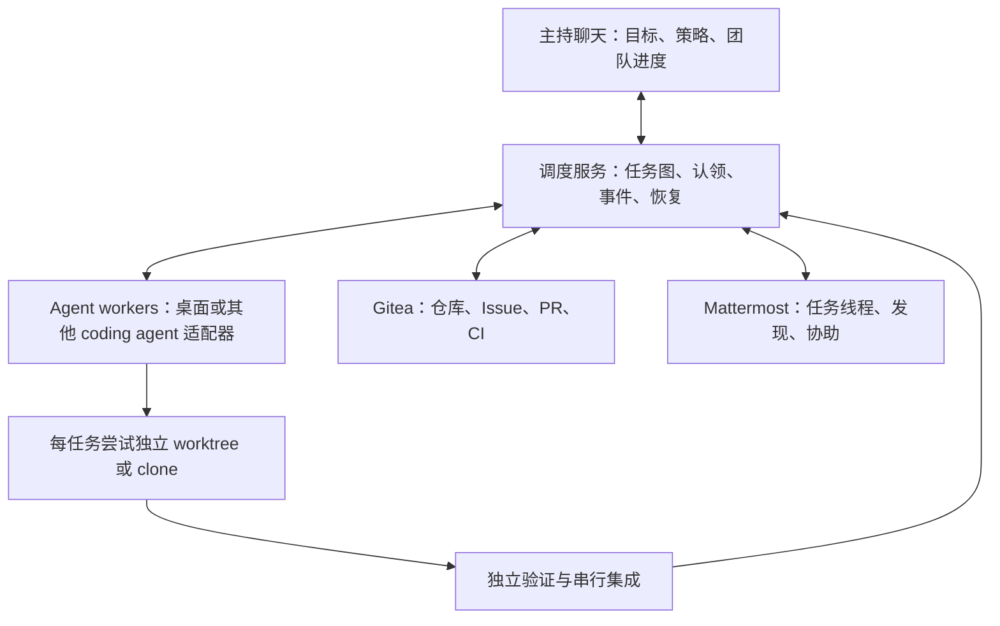

# 自组织 coding agent 协作：可行性与改造清单

初始研究日期：2026-10-26（Asia/Shanghai），基于 v1.6.2 源码及官方资料。用户随后确定采用现有 Gitee + 本地调度/消息箱 + 独立 worktree，暂不接 Gitea/Mattermost。v1.7.0 已实现本地闭环，v1.8.0 新增 Gitee Issue/PR 同步并完成真实验证。进度见 [交接](../HANDOFF.md)、[团队说明](../skills/work-together/references/team.md)、[Gitee 接入](../skills/work-together/references/gitee.md)和 [验证记录](verification-1.8.0.md)。下文保留研究阶段路线和可选服务比较，任务表不是全部已完成清单；外部聊天、多机、Gitee WebHook/CI 等仍属后续。

## 1. 结论与范围

可行，建议采用“主持方设目标和边界，agent 自主提议/认领，调度服务原子裁决，验证后串行集成”的方式。在现有多桌面会话调度基础上扩展，不让普通聊天消息直接成为任务归属或合并成功的依据。

Gitea 是共享的代码、Issue、PR、检查结果入口；Mattermost 是共享发现、请求协助和通知入口；调度服务负责唯一任务归属、重试、状态与进度。运行状态不能靠多个 agent 同时编辑 Git 中的 JSON 来仲裁，也不能靠 Issue assignee 或“我来做”消息保证互斥。

“共享工作区”应是共同仓库与版本化上下文，每个任务尝试有独立工作目录。同一物理目录直接并发写入，不适合作为扩大规模后的默认方式。

## 2. 当前能力与差距

| 诉求 | 现有实现 | 必要变化 |
|---|---|---|
| 一个执行方接多个任务 | 可配置多个 tasks 指向同一 engine；每包创建会话 | 区分同一客户端、多个 agent 实例与同一 agent 的任务队列；验证桌面原生并发能力 |
| 多执行方并行 | 支持逐包指定 engine、依赖和文件冲突串行 | 增加负载/能力/额度感知；auto 目前总取首个可用候选，不自动均衡 |
| 自动拆分 | 依靠主持聊天写固定 plan | 新增结构化拆分器与确定性校验；保留手写 plan |
| 动态追加子任务 | planHash 禁止运行后静默改计划 | 用版本化任务图和显式变更事件，不能简单移除计划校验 |
| 自主认领 | 单 runner 集中派发，无认领接口 | agent 注册、原子 claim、租约、心跳、尝试代次与恢复仲裁 |
| 共享发现 | 执行者提示词禁止共享记忆落盘，由主持方汇总 | 增加结构化发布/订阅和任务相关上下文包 |
| 独立验证 | exec_done 后由主持方登记 verified | 绑定提交 SHA、证据、审核身份，增加集成状态 |
| 自动集成 | 提示词禁止执行者提交/推送；无合并队列 | 任务分支、受控提交/PR、串行集成和集成后验证 |
| 展示 agent 状态 | status/STATUS.md 目前按任务展示 | 同时展示 agent、任务、队列、阻塞、心跳、PR、验证与集成情况 |
| 持续运行 | 聊天回合结束后无自动唤醒 | 持久调度进程与事件恢复；聊天作为可断开的查看/管理入口 |

源码入口：core.mjs 的 validatePlan/canStart/boundaryChanges；executors.mjs 的 candidates/selectExecutor；workflow.mjs 的任务循环、planHash、提示词、render、verify/takeover。脚本均位于 skills/work-together/scripts/。

现有并发上限是 1..4，不能只放宽数字就宣称支持任意数量。探测、创建、派发、快照等操作目前存在顺序等待，UI 导航也有共享状态；需要分别控制后台执行容量与桌面显示/导航互斥。Qoder snapshot 会调用 openChatSession，扩大并发前要实测是否影响其他任务。

## 3. 推荐结构

建议保留 local 模式，以本地 Git 和本地消息箱即可运行；team 模式再启用 Gitea/Mattermost。两种模式复用任务协议，不把外部服务变成单机使用的强制依赖。

### 身份与容量

- engine 是客户端/后端类型，例如 zcode；agentId 是执行实例，例如 zcode-01；taskId 是工作项；attemptId 是某次执行；sessionId 是原生会话。一个 engine 可有多个 agent，一个 agent 可排队多个任务。
- 默认每个会话同时执行一项任务。若同一客户端允许多会话后台并发，可注册多个 agent 实例；具体容量来自探测和配置，不能从会话可创建推断出来。
- 调度顺序先满足权限、模型免费策略、能力、依赖、文件/资源约束，再按候选偏好和容量分配。保留旧 strict-priority，新增 balanced/claim 模式，不悄悄改变旧 auto 语义。
- agent 可自主选 eligible 任务并提议拆分/求助；服务决定唯一 claim。主持方保留范围、预算、验收与合并策略控制，不必逐个子任务人工确认。

### 自动拆分与上下文

输入目标、Spec、目录/符号索引、接口约定、现有测试和资源预算；输出任务图。每项包含 parentId、目标、输入、产物、归属、依赖、验收、能力要求、预估规模、禁止修改项及上下文版本。

拆分器先固定跨模块接口，再并行实现；同一文件或共享资源不能安全拆分时维持串行。设置最大层数、任务数、总预算和最低任务粒度，避免递归膨胀。代码校验环、遗漏验收、路径越界和契约冲突；模型估算不作为完成证据。

运行中通过 task.proposed/task.admitted/plan.revised 扩展任务图。旧 plan 和任务尝试保持可追溯；已运行任务不被静默改归属。范围内新增任务可按主持策略自动接纳，超出范围或涉及外部动作时沿用相应授权边界。

共享发现使用结构化记录：findingId、作者、关联任务、结论、证据、相关路径/commit、有效上下文版本、confirmed/hypothesis/superseded。上下文包包含 Spec、契约、相关发现、依赖产物及其 SHA；只向相关 agent 投递增量，避免全频道聊天反复塞满上下文。

### 原子认领、消息和恢复

由一个权威服务事务性地执行 claim(taskId, agentId, expectedRevision)，返回 claimToken、attemptId、leaseUntil；并发认领只有一方成功。单机可用本地事务数据库；跨机器也通过服务 API，不能把 SQLite 放 Git 或共享目录供所有进程直接写。

事件包含 eventId、runId、taskId、attemptId、producer、revision、causationId、时间与结构化载荷。持久 inbox/outbox、幂等键和定期对账处理重复、乱序、断线与重启；目标是重复投递不产生重复副作用，不能承诺网络层恰好一次。

租约过期先标 suspect/unknown。确认原会话停止后重派；若停止无法确认，只有隔离旧工作区并拒收旧代次结果等条件成立后才能按策略启动新尝试。代次令牌能防止旧结果被接纳，不能自动阻止失联进程继续写文件，必须配合隔离。

单个 agent 失联不应终止其他健康任务的监控。目前 workflow 遇 unknown 会退出循环，应改为局部隔离、继续观测其余任务。主持方接管还需调度领导者代次/租约，防止两个服务同时发任务。

Mattermost 的消息由适配器转成经过鉴权和校验的命令/事件，普通文本、引用和外部内容不能直接驱动任意 shell 或合并。消息到达不等于 agent 已处理：本地 worker 在安全检查点读取 inbox，记录消费游标，必要时只在原会话空闲后送入新一轮请求。

### 工作区与验证集成

每个任务尝试使用独立 worktree/分支，多机器使用独立 clone；任务完成后再回收。worktree 不是安全沙箱，仍须限制路径、资源和凭据。每任务使用独立构建/测试目录，跨 worktree 的 Git 共享管理操作由控制器协调。

当前 boundaryChanges 按全部 tasks 的归属并集检测，无法准确区分“甲改了乙的归属”。新模式按任务工作区及其 base SHA 比对，只认可本包归属，保留每包变更证据。

执行者自测交回后，独立验证者检查精确提交、差异、验收证据及必要测试；保留现有禁止默认自验的约束，不能因新增 agentId 就默默放宽为同族自验。

建议保留 exec_done/verified，增加 integrating/merged/integration_failed；任务 verified 不等于团队结果已经集成。依赖任务默认基于已集成依赖启动；若采用堆叠分支，必须显式记录依赖提交，不能只解锁任务却不给代码。

集成队列由唯一写入者串行更新候选分支，在“当前目标分支 + 本次变更”上测试，再合并。PR head 或目标基线变化使相关证据失效，需重测；不能沿用旧 SHA 的绿灯。冲突生成专门解决任务，修复后重新验证，禁止无声覆盖。

一键 collect 可统一触发检查、队列集成、团队测试、进度汇总；它不意味着并发修改主分支或跳过审核。提交/推送只由受控工作区控制器执行，或者明确授予 agent 自己分支的权限，不能直接删除现有禁止 Git 操作的提示词。

## 4. 分阶段任务清单与修改意见

下表是建议实施顺序，不代表已经执行。P0/P1/P2 为推进阶段。

| ID | 阶段 | 任务 / 建议文件 | 验收条件 |
|---|---|---|---|
| T01 | P0 | 统一同族/接管策略；executors.mjs、workflow.mjs、README | 正常选择、失败切换和 fallback=false 均遵守现任主持方策略；既有恢复不退化 |
| T02 | P0 | 定义 v2 数据协议及 v1 迁移；新增 protocol.mjs，调整 core.mjs | engine/agent/task/attempt 身份独立，旧 plan 可运行，非法事件和循环被拒绝 |
| T03 | P0 | 拆分 workflow 为 CLI 与常驻调度核心；新增 scheduler.mjs、store.mjs | 重启恢复同一任务，不重复派发；事件与状态事务一致 |
| T04 | P0 | agent 注册与容量调度；新增 agents.mjs，调整 executors.mjs | 支持一个 engine 多实例、多任务排队、跨 engine 分配；容量和免费策略不被突破 |
| T05 | P0 | 自动拆分及增量任务图；新增 planner.mjs、task-graph.mjs | Spec 生成带归属/验收的 DAG；运行中合法加任务，可追溯，失败不污染原图 |
| T06 | P0 | 原子 claim、心跳、代次和局部故障恢复；scheduler/store | 同时抢同一任务仅一个成功；重复请求幂等，旧代次结果被拒，失联不拖停健康任务 |
| T07 | P0 | 每任务尝试 worktree 与资源锁；新增 workspace.mjs，改桥接 cwd 路由 | 两包文件/构建输出隔离；按各包归属检测；活跃分支不被回收 |
| T08 | P1 | 结构化发现、上下文快照和本地消息接口；新增 context.mjs、events.mjs | 发现有证据/版本，相关任务收到增量，重复消息不重复触发工作 |
| T09 | P1 | Gitea 适配；新增 integrations/gitea.mjs | 任务可映射 Issue/PR、提交和检查结果；重复 webhook 不重复建单，断线后可对账 |
| T10 | P1 | Mattermost bot、任务线程和命令入口；新增 integrations/mattermost.mjs | 通知与求助可双向流转；重连补读、反馈环抑制、身份映射、凭据隔离通过 |
| T11 | P1 | 独立 verifier 与串行集成队列；新增 verification.mjs、integration.mjs | 精确 SHA 证据、作者自验限制、目标变化重测、冲突任务、重复 collect 均可验证 |
| T12 | P1 | agent 视图、团队汇总及文档；status/watch/render、SKILL、operations/faq | 显示 agent 当前任务/队列/阻塞/心跳/PR；完成数和集成数分开；聊天重连能看最新状态 |
| T13 | P2 | 自主提议拆分、协商和认领；planner/scheduler/context | 在预算和范围内自动协作，防重复拆分、循环求助及无限衍生 |
| T14 | P2 | 多机 worker、适配器能力协商与领导者恢复 | 服务/worker/消息系统任一重启不导致双重执行或错误合并；兼容原桌面会话恢复 |
| T15 | 各阶段 | 性能基准与故障注入回归；新增对应 tests | 顺序/并行/均衡对比总耗时、资源、重试、冲突和有效集成数；不以进程数充当加速证据 |

推荐首个可交付切片为 T01～T07 加最小 status：先证明“自动拆分 → 多实例分配/认领 → 隔离执行 → 可靠恢复”，再接 T08～T12。可以用模拟 agent 做故障测试，但必须另做真实桌面多会话验收。

## 5. 主持方展示与成功标准

示意视图（虚构状态，不是当前运行结果）：

| Agent | 当前任务 | 等待队列 | 状态 | 依赖/协作 | 交付 |
|---|---|---|---|---|---|
| zcode-01 | T-api | T-doc | running | 已收到接口契约 v3 | 分支已分配 |
| qoder-01 | T-ui | — | blocked | 等待 T-api 集成 | 暂无 PR |
| wb-01 | T-tests | — | exec_done | 等待独立验证 | PR 待检查 |
| reviewer-01 | 验证 T-tests | — | reviewing | 对应精确提交 | 证据生成中 |

同时展示最后心跳、原生会话入口、待处理问题、重试次数、预算与已知发现；只汇报有意义的变化。团队进度按“已拆分、可执行、执行中、待验证、已验证、已集成、阻塞”统计，未知总工作量时不输出虚假的百分比。

必测场景包括：双重认领；服务提交状态后消息发送失败；发送受理但应答丢失；旧 agent 复活；消息重复/乱序；Gitea 或 Mattermost 暂时不可用；同一文件/锁文件/数据库冲突；作者试图自验；测试后提交变化；集成时目标变化；主持接管；运行中新增任务；某包 unknown 而其他包继续完成。

速度收益需实测。独立模块多、验收清楚时更适合并行；共享文件多、依赖长、模型额度低或私有桥吞吐有限时，协调成本可能抵消收益。建议同一真实任务比较顺序、当前固定调度和新均衡调度，不预先承诺倍数。

## 6. 官方依据与未验证事项

- Gitea 提供 API 和实例自身 OpenAPI；接入时以目标实例的 swagger.v1.json 为准，不假设线上文档等同部署版本：[API Usage](https://docs.gitea.com/development/api-usage/)。
- Gitea webhook 支持仓库/Issue/PR 等事件及签名；适配层据此接收变更，同时自行实现业务幂等和补偿：[Webhooks](https://docs.gitea.com/usage/repository/webhooks/)。
- Gitea 受保护分支可配置评审和状态检查；它可作为合并门槛，是否满足本方案仍需对目标版本逐项验证：[Protected branches](https://docs.gitea.com/usage/access-control/protected-branches/)。CI 另需实际部署 runner：[Actions overview](https://docs.gitea.com/usage/actions/overview/)。
- Mattermost 有 REST API、WebSocket 事件和 bot 账号，可作为消息适配基础；持久队列、任务互斥和断线补偿是本方案增加的职责：[Mattermost API](https://docs.mattermost.com/api/reference/mattermost-api)、[Bot accounts](https://docs.mattermost.com/developers/integrate/reference/bot-accounts)。
- outgoing webhook 有频道等使用限制，不应只靠它构建双向 agent 协议；推荐 bot + REST/WebSocket：[Outgoing webhooks](https://docs.mattermost.com/developers/integrate/webhooks/outgoing)。
- Git worktree 支持一个仓库多个工作树，适用于本机任务分支；跨机器使用 clone，安全与资源隔离需另行实现：[git-worktree](https://git-scm.com/docs/git-worktree)。

未检查目标服务地址、部署、许可/配置、bot 创建权限、令牌范围、网络可达性及桌面并发配额。以上架构与优先级为基于源码和公开接口的工程判断，不是已完成的集成验证。
